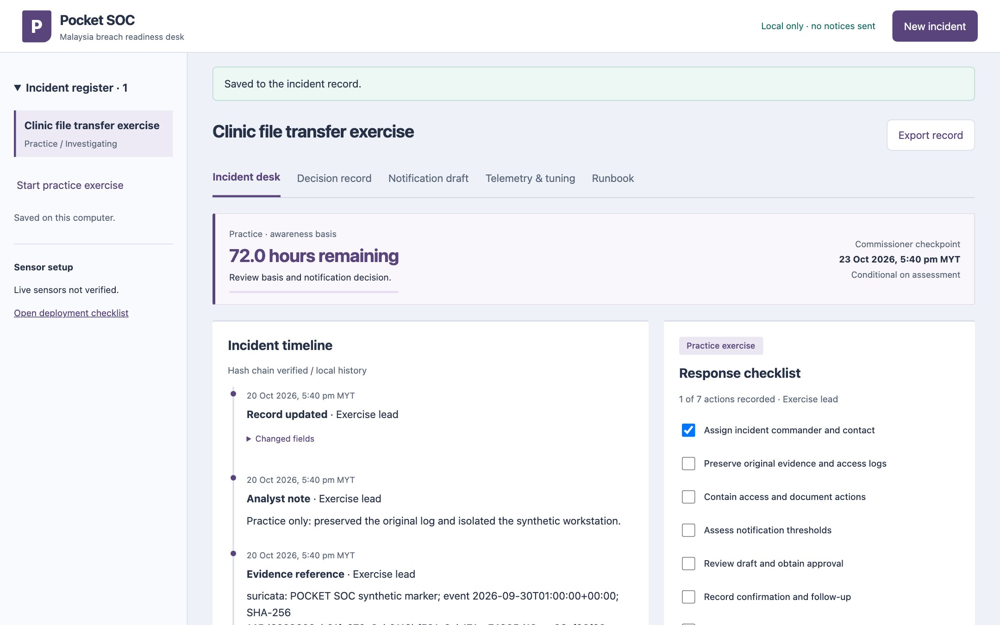
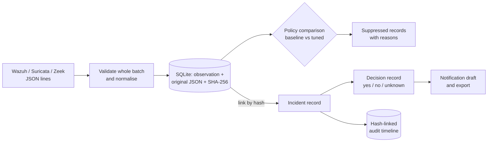
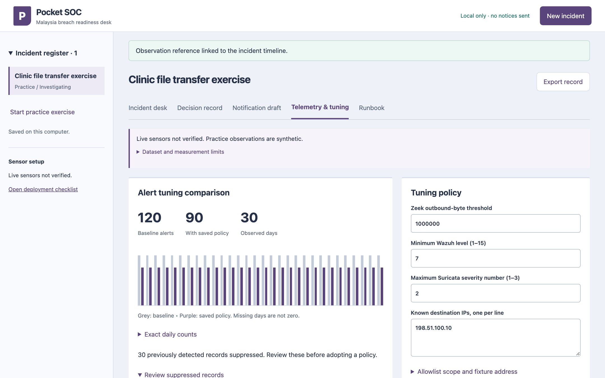
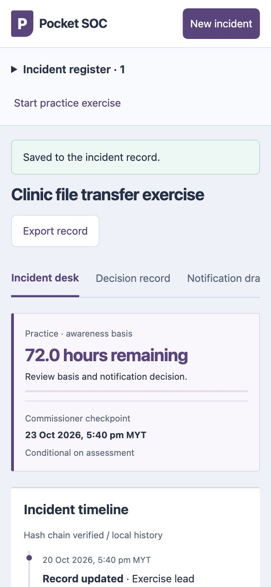

# Pocket SOC

A local incident desk for small organisations in Malaysia that need to handle a possible personal-data breach under the PDPA (Personal Data Protection Act): it turns sensor logs into evidence, records what is known and unknown, and prepares a notification for a human to review. It never sends one.



A SOC (security operations centre) is usually a team with a SIEM and a budget. A clinic or a small office has neither, but it still has a 72-hour planning window once it becomes aware of a breach. Pocket SOC is the smallest useful version: one operator, one laptop, one record that holds the logs, the decisions and the draft together.

## What it does

- **Keeps an incident register.** Each incident has an owner, a status, a response checklist and a timeline. Every change is appended to a hash-linked audit trail.
- **Normalises sensor records without losing them.** Wazuh alerts, Suricata EVE events and Zeek connection logs are mapped to one shape (time, source, addresses, severity, bytes), while the original JSON is kept with its SHA-256. An analyst can link any observation to an incident by its hash.
- **Records facts as yes, no or unknown.** The decision record asks about personal data, harm and the number of affected people. Unknown stays unknown and is listed as a reason, rather than being treated as "no".
- **Compares a baseline with a tuned detection policy.** It shows both alert counts per day and lists every suppressed record with the reason it was suppressed.
- **Prepares a notification.** Draft fields map to the paragraphs of the JPDP (Personal Data Protection Department) breach notification guideline. Export gives a JSON record of saved data; nothing is transmitted.

## How it works



Logs arrive through the browser, the command line or a small collector (`ops/tail_ingest.py`) that follows a log file with checkpoints. A batch is validated in full before anything is stored, and a record that was already imported is skipped. The same records are evaluated twice, once against the default thresholds and once against the saved policy, so suppression is always visible. Incident changes go into a timeline where each entry hashes the one before it. The browser talks to a small Python server bound to `127.0.0.1` only, with Host and Origin checks and a per-session CSRF token.

## Design decisions

**Fewer alerts doesn't mean better detection.** Allowlisting the synthetic backup server (`198.51.100.10`) takes the fixture from 120 alerts to 90. That looks like progress, but the tool refuses to call it a false-positive reduction: there are no analyst labels saying those 30 were harmless. So every suppressed record stays listed with its reason. The same control can hide the incident itself: allowlisting the destination in the practice scenario (`203.0.113.70`) suppresses 60 records, which a test pins down.

**Unknown stays unknown.** Each harm question has three answers, and "unknown" is a real state, not a blank that means "no". If any criterion is unknown, the result says "undetermined" and lists what is missing. More than 1,000 affected people is a scale trigger for notifying the Commissioner, but on its own it does not decide whether individuals must be told; the two recommendations are kept separate and the reviewer still owns the decision.

**Hashes show change, not truth.** The timeline hash chain detects an edited or reordered history, and the UI says when it fails to verify. It does not prove that the history was true to begin with, and someone who controls the database can rewrite the whole chain. For stronger assurance, export the record and keep an anchor outside the machine.

**Keep the original next to the normalised record.** Normalisation throws detail away. Storing the canonical raw JSON and its SHA-256 means an analyst can always go back to exactly what the sensor said, and the hash makes duplicates and later edits visible.

**Record both clocks.** The guideline's text and its worked examples differ on when the 72-hour window starts. The desk stores occurrence and awareness times, asks which basis applies and why, and labels the deadline as conditional.

## Screenshots

<table>
  <tr>
    <td width="70%"></td>
    <td width="30%"></td>
  </tr>
  <tr>
    <td>Telemetry and tuning: baseline and tuned counts per day, the saved policy, and the 30 suppressed records waiting for review.</td>
    <td>The incident desk at 390 px. The register collapses and panels stack.</td>
  </tr>
</table>

## Run it

Python 3.11 or newer. There are no runtime dependencies beyond the standard library.

```sh
git clone https://github.com/lilsallix05/pocket-soc.git
cd pocket-soc
python3 -m venv .venv
source .venv/bin/activate
python soc.py --db work/demo.sqlite serve --port 8765
```

Open http://127.0.0.1:8765 and click **Start practice exercise**. This creates the labelled synthetic clinic incident and imports 150 synthetic observations across 30 days. Then:

1. **Decision record**: set personal data to Yes, 240 affected people, sensitive data Yes, and save. Notice that 240 alone is below the scale trigger; the sensitive-data answer drives the result.
2. **Telemetry & tuning**: add `198.51.100.10` as a known destination and compare. Open the suppressed records.
3. Search `203.0.113.70`, open a source record and link it to the incident.
4. **Notification draft**: fill a field, save and export.

The command line works without the browser:

```sh
python soc.py --db work/demo.sqlite ingest --source zeek fixtures/zeek.jsonl
python soc.py --db work/demo.sqlite report-tuning
python soc.py benchmark
```

## Tests

```sh
python -m unittest discover -s tests -v
```

Result on 20 October 2026 (Python 3.14, macOS): **13 tests, all passing.** They cover deadline timezones, the scale boundary, unknown facts, tamper detection, atomic imports, deduplication, collector rotation and partial lines, private-network classification, HTTP request guards and the fixture comparison (150 records, 120 baseline, 90 tuned, 30 suppressed).

An optional end-to-end browser journey (`tests/browser-check.cjs`, Node and Playwright with Google Chrome) creates an incident, saves an assessment, tunes the policy, links evidence, exports, and checks the 390 px layout. It passed 13 of 13 checks on the same day. `tests/responsive-check.cjs` runs a wider viewport and error-state sweep; it was not rerun for this release.

## Scope

- All logs, the clinic, its patients and the people in the exercise are synthetic. External addresses use documentation ranges.
- Native Wazuh, Suricata and Zeek have not been run against this tool. `ops/` holds configuration fragments and a systemd unit, and `docs/DEPLOYMENT.md` describes how a consenting site would validate them.
- The 30-day dataset is for comparing policies, not a measured month of production traffic. `docs/30-DAY-REPORT.csv` is the empty template for a real one.
- It is a single-operator local tool: no login, no multi-user conflict handling, no encrypted database.
- The recommendations reflect only the recorded criteria. They are not legal determinations, and the current official form and a designated reviewer are still required. Source mapping is in `docs/SOURCES.md`.
- Next: run the sensors on a Linux box with an owned packet capture, measure end-to-end latency, and run the tabletop in `docs/TABLETOP.md` with real participants.

## Project layout

```
soc.py                  storage, normalisers, policy comparison, clocks, CLI
server.py               loopback HTTP API with Host/Origin and CSRF checks
static/                 browser interface (HTML, CSS, JS, no build step)
ops/tail_ingest.py      checkpointed log-file collector
ops/                    Wazuh, Suricata and Zeek fragments, systemd unit
fixtures/               synthetic 30-day logs and their generator
tests/                  unit, integration, HTTP and browser checks
docs/                   runbooks (English, Malay), tabletop, deployment, sources, design
```

---

Built by Selbinyyaz (Salli) Odekova · [Portfolio](https://selbinyyaz-odekova.web.app) · MIT License
